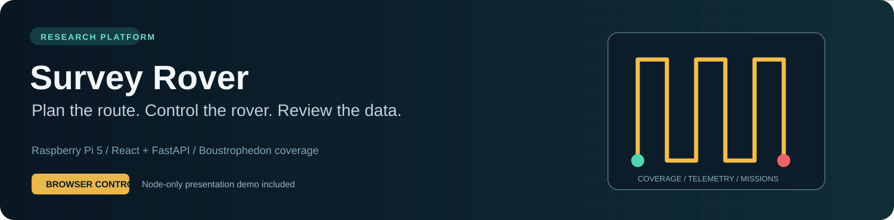
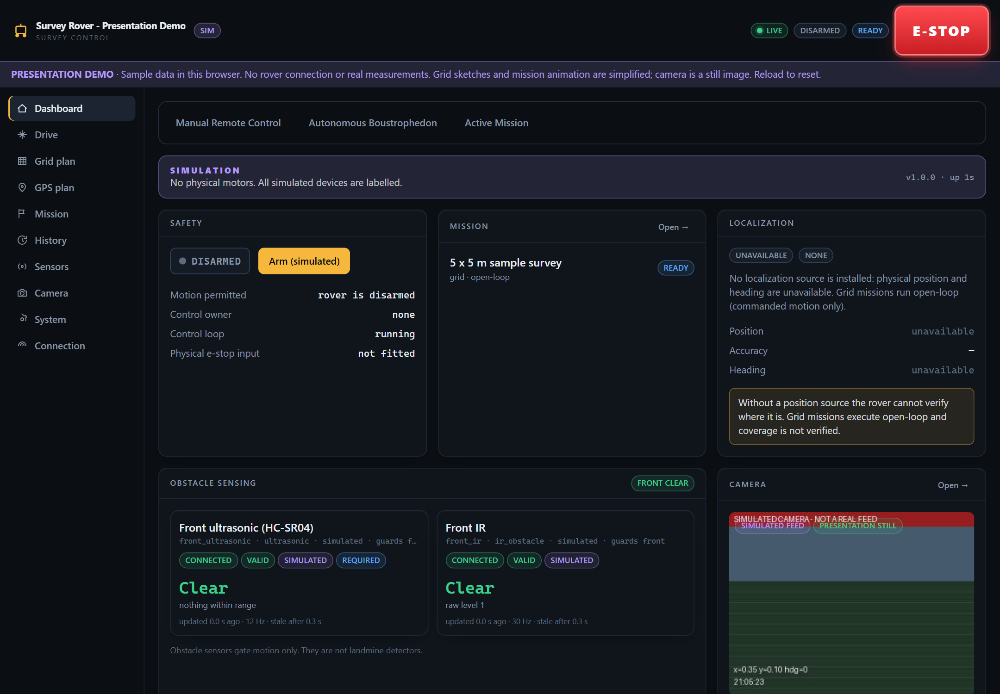
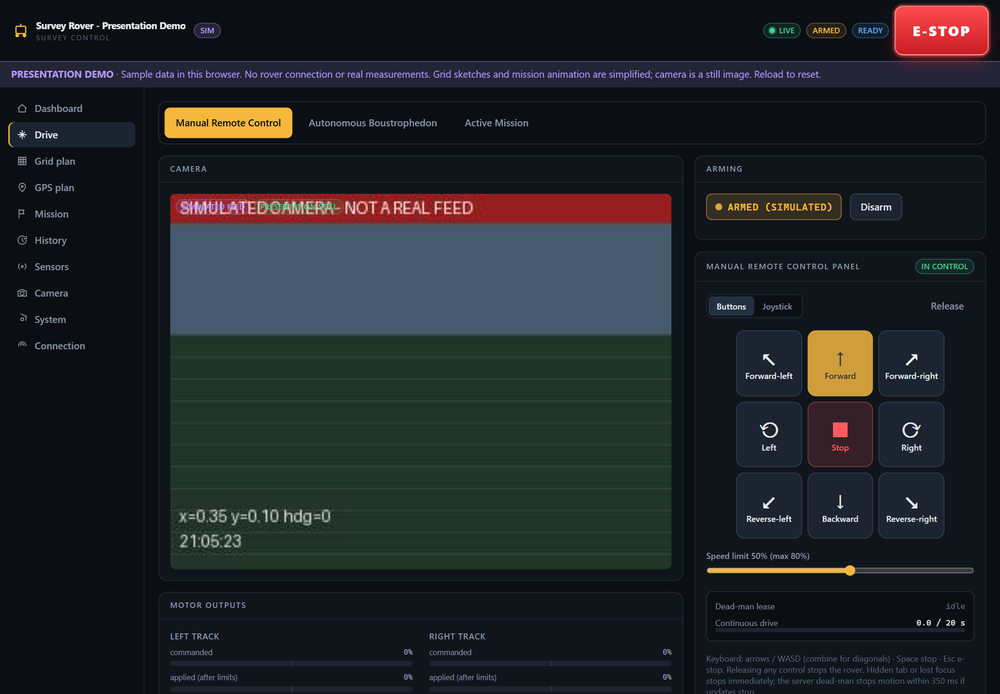
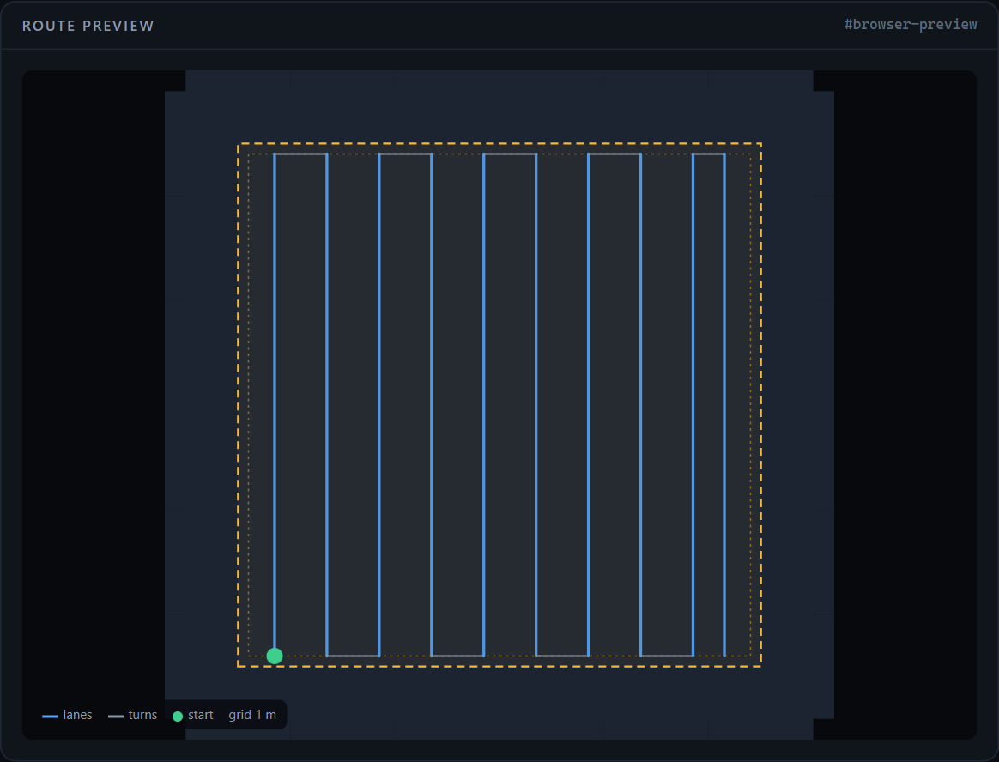

<div align="center">



# Autonomous Survey Rover Platform

**A browser-based control and survey interface for a Raspberry Pi 5 rover.**

Manual remote control · Boustrophedon coverage · Mission monitoring · Sensor telemetry · Camera candidates

[Mac demo guide (PDF)](output/pdf/Mac_Frontend_Demo_Guide.pdf) · [Frontend-only demo](#show-the-frontend-without-a-rover) · [Features](#what-the-interface-can-do) · [Pi deployment](#deploy-on-raspberry-pi-5) · [Documentation](#documentation)

</div>

## Start here

This project brings rover controls, survey planning, safety status and sensor data into one responsive web interface. The physical platform uses a Raspberry Pi 5, an L298N motor driver, ultrasonic/IR obstacle sensors and an optional CSI Pi Camera or ESP32-CAM. A laptop or tablet acts as the operator console.

There are three useful ways to run it:

| What you want | Run this | What you need |
| --- | --- | --- |
| Show the website to a guide | **Browser presentation demo** | Node.js only; no Python or rover |
| Exercise the actual backend and planner | **Full laptop simulation** | Python + Node.js; no rover |
| Operate the physical rover | **Raspberry Pi deployment** | Pi 5, wired hardware, measured calibration |

> **Project scope:** this is a research prototype for controlled surveys and unverified candidate logging. Camera detections are not proof of a mine, and obstacle sensors do not detect buried hazards. Open-loop progress is commanded motion, not verified coverage. Physical operation requires the independent motor-power cut-off described in [Safety](docs/SAFETY.md).

## Show the frontend without a rover

The dedicated presentation mode runs entirely in the browser. It loads sample data, offers a simplified rectangular route preview and animates sample mission progress. It never opens a rover API or control WebSocket connection.

### First-time setup

1. Install **Node.js LTS** from [nodejs.org](https://nodejs.org/en/download). npm is included. On a Mac, choose the macOS installer matching Apple Silicon or Intel.
2. [Download this repository as a ZIP](https://github.com/AnshadityaSharma/pjt-1/archive/refs/heads/main.zip) and unzip it. You can also clone it:

   ```bash
   git clone https://github.com/AnshadityaSharma/pjt-1.git
   ```

3. Open Terminal in the extracted project's `frontend` folder. For the usual ZIP download location on a Mac:

   ```bash
   cd ~/Downloads/pjt-1-main/frontend
   npm ci
   npm run demo
   ```

4. Open the **Local** address printed in Terminal, normally [http://localhost:5173](http://localhost:5173). Leave Terminal running. Stop it with **Control + C**.

If you cloned instead of downloading the ZIP, enter your cloned `pjt-1/frontend` folder. If the ZIP was renamed, use its actual folder name. On later runs, only `cd .../frontend` and `npm run demo` are needed.

**Beginner on macOS?** Follow the illustrated [Mac Frontend Demo Guide](output/pdf/Mac_Frontend_Demo_Guide.pdf) for installation, reopening, presentation steps and troubleshooting.

### A short demonstration

- Start at **Dashboard** and point out the presentation banner, safety state and sample sensors.
- Open **Manual Remote Control**, choose **Take manual control**, and **Arm (simulated)**. Hold a direction button or an arrow/WASD key; release to stop the sample output. Try the speed slider or joystick, then **Release** the session.
- Open **Autonomous Boustrophedon**, select **Quick 5m x 5m Demo Box**, and explain the alternating lanes. Change dimensions or spacing to update the simplified sketch; choose **Pivot** turns in this mode.
- Select **Save & load mission**, then **Start mission**. Show **Pause**, **Resume** and the sample progress animation.
- Finish with the sensor and camera pages, and the large red E-stop. Reload the browser to reset the presentation.

The demo's camera is a labelled still image. Sensor readings are examples, calibration changes stay in browser memory, and mission animation is not a physics simulation. Polygon route generation, exact pivot/arc geometry, geographic projection, saved boundaries and fault injection require the full backend. Internet is needed for the first install and for online map tiles; the local grid sketch does not depend on tiles.

## Interface gallery

### Dashboard: one view of the survey



*Browser presentation screenshot. The violet banner identifies sample data; no physical measurements are shown.*

### Manual remote control



*Directional buttons, diagonals, joystick and keyboard control share the same operator workflow.*

### Coverage planning



*Boustrophedon means back-and-forth coverage. This screenshot is the simplified browser preview; the backend implements the complete planner.*

## What the interface can do

| Screen / function | Implemented workflow |
| --- | --- |
| **Dashboard** | Arming state, motion ownership, mission overview, localization, sensor health, camera, capabilities and events |
| **Manual remote control** | Forward/backward, left/right pivots, diagonals, joystick, keyboard arrows/WASD, speed limit, explicit stop and session release |
| **Safety** | Disarmed startup, preflight checks, command leases, dead-man timeout, reversal dwell, motor watchdog, obstacle gating and latched E-stop |
| **Grid planner** | Rectangular coverage in m/cm/mm; spacing, swath, margins, start corner, lane orientation, pivot or arc turns, route summary and warnings |
| **GPS planner** | Draw/edit/save geographic boundaries, choose a start vertex, preview coverage and use a local metric ENU planning frame |
| **GPS anchor & calibration** | Device GPS or manual/map origin; grid bearing; 5 x 5 m preset; measured speed and 90-degree pivot time through UI/API |
| **Active mission** | Save/load/start/pause/resume/stop, progress, lane count, elapsed time, trace and estimated/measured position labels |
| **History** | Mission records, outcomes, review notes, detections and timeline |
| **Sensors** | Per-device readings, validity, age, connection state, calibration context and optional hardware availability |
| **Camera & vision** | Picamera2, OpenCV V4L2 or ESP32-CAM ingest; backend MJPEG distribution; optional YOLOv8n ONNX inference and candidate events |
| **Detection alerts** | Configured candidate classes can stop/disarm, pause a mission, save the inference frame, log position/context and display an alert/marker |
| **System & connection** | Hardware/init status, faults, effective configuration, full-simulator fault injection, backend URL and optional access token |

### Position and detection are labelled honestly

- A device GPS anchor gives a fixed reference point; it does not continuously measure rover position.
- Without localization hardware, grid execution integrates applied commands with the calibration model. Wheel slip or a stalled rover can still create drift.
- Experimental encoder odometry is distinct from command-based estimation. Real encoder/IMU/magnetometer adapters depend on the selected hardware.
- Custom ONNX weights must match the configured classes. Stock COCO weights cannot be renamed into a landmine detector. Missing models or drivers report unavailable.
- A detection's local/geographic coordinates are rover position context, not a measured camera-to-object location.

## Run the full laptop simulator

Use this when you need the real Python planner, simulated sensors, mission execution or fault injection. This is separate from the Node-only presentation mode.

**Terminal 1 - backend (from the repository root):**

```bash
cd backend
python3 -m venv .venv
source .venv/bin/activate              # Windows: .venv\Scripts\activate
python -m pip install -e .
python -m rover --config config/simulation.yaml
```

**Terminal 2 - frontend (from the repository root):**

```bash
cd frontend
npm ci
npm run dev
```

Open the frontend's printed Local URL. Vite proxies `/api` and `/ws` to `localhost:8000`. Use `simulation_gps.yaml` to exercise simulated GPS. Build with `npm run build` if you want the backend to serve the static UI from `frontend/dist`.

## Deploy on Raspberry Pi 5

Read [Hardware](docs/HARDWARE.md), [Safety](docs/SAFETY.md) and [Calibration](docs/CALIBRATION.md) before connecting motor power.

```bash
git clone https://github.com/AnshadityaSharma/pjt-1.git ~/rover
cd ~/rover
./deploy/install_pi.sh --config config/hardware.yaml --vision
```

The installer sets up Python, gpiozero/lgpio and Picamera2 support, a virtual environment with system packages, configuration validation and the backend systemd service. Add `--build-frontend` when Node.js is installed on the Pi. The default CSI camera configuration expects custom weights at `backend/models/landmine_yolov8n.onnx`; provide those separately. ESP32-CAM and V4L2 are alternative providers.

All GPIO access goes through the hardware abstraction layer. Outputs/PWM use an explicit gpiozero `LGPIOFactory`; inputs and echo timestamps use lgpio. Auto-detection requires the RP1 header controller. Laptop simulation does not require GPIO libraries.

| Mode | Backend configuration | Position source |
| --- | --- | --- |
| Laptop simulation | `config/simulation.yaml` | Command estimate by default; simulation truth is separately labelled |
| Simulated GPS | `config/simulation_gps.yaml` | Simulated receiver |
| Pi without GPS | `config/hardware.yaml` | Calibrated command estimate / configured local provider |
| Pi with GNSS | `config/hardware_gps.yaml` | NMEA UART/USB receiver |

Hardware drivers are implemented but need verification on the physical rover. A failed real device is never silently replaced by a simulated one.

## Repository map

```text
frontend/       React + TypeScript + Vite + Tailwind operator interface
  src/demo/     Explicit browser-only presentation data and interactions
backend/        Python 3.11+ FastAPI application and pytest suite
  config/       Validated simulation and hardware YAML configurations
  rover/        Motion, HAL, sensors, planning, missions, localization, vision, API
firmware/       ESP32-CAM streaming firmware
deploy/         Raspberry Pi installer and systemd unit
docs/           Technical guides and interface screenshots
output/pdf/     Beginner macOS frontend demonstration guide
tools/presentation/  Maintainer tools for presentation assets
```

## Development checks

```bash
# Backend: after installing development dependencies
cd backend
python -m pip install -e ".[dev]"
python -m pytest -q

# Frontend: from frontend/
npm test
npm run build
```

A build checks TypeScript and produces the deployable UI. Passing automated checks does not verify GPIO timing, physical motor direction, real GPS reception or detector accuracy.

## Documentation

| Guide | Contents |
| --- | --- |
| [Mac presentation guide (PDF)](output/pdf/Mac_Frontend_Demo_Guide.pdf) | Beginner setup, screenshots, feature tour and troubleshooting |
| [Architecture](docs/ARCHITECTURE.md) | Subsystems, ownership, state, threading and simulation time |
| [Hardware](docs/HARDWARE.md) / [Safety](docs/SAFETY.md) | Wiring, RP1 GPIO, electrical requirements and stopping behaviour |
| [Calibration](docs/CALIBRATION.md) / [Anchored survey](docs/ANCHORED_SURVEY.md) | Motion model, origin, camera alerts and measured calibration |
| [Sensors](docs/SENSORS.md) / [Coordinates](docs/COORDINATES.md) | Device interfaces, capability matrix and reference frames |
| [Camera & vision](docs/CAMERA_VISION.md) | Camera ingest, model export and limitations |
| [API](docs/API.md) / [Operations](docs/OPERATIONS.md) / [Testing](docs/TESTING.md) | Endpoints, field workflow and verification |

---

**For a presentation:** start with `npm run demo`. **For actual simulation:** use the Python backend and `npm run dev`. **For hardware:** follow the Pi setup and bench procedure first.
